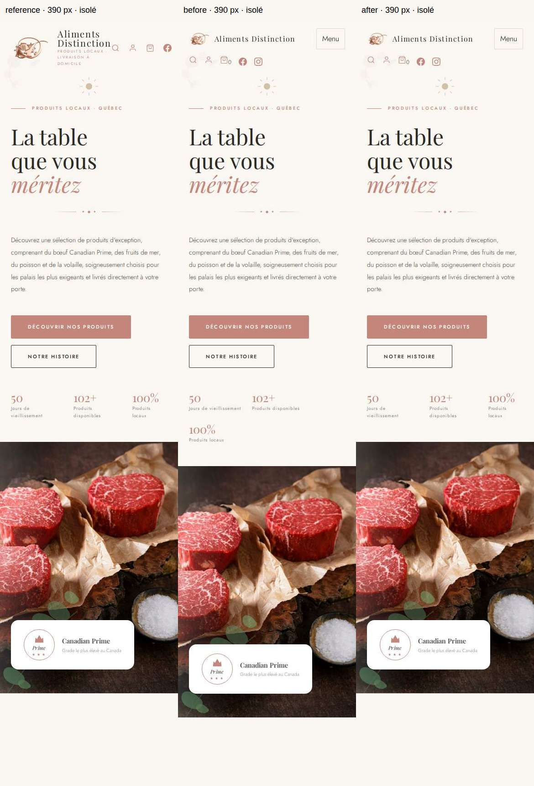

# P0 — diagnostic et correction du décalage mobile

**État final : correctif 0.1.1 déployé et recetté sur le WordPress temporaire.** Run de déploiement 39685183348 puis [recette hébergée 39686849316](https://github.com/mycomane/alimentsdistinction/actions/runs/39686849316) : 88 contrôles réussis, écart mesuré 0,00 px à 320/390/768/1024/1440. Compte supprimé/sessions révoquées, Coming Soon conservé. [Rapport final](P0_POSTDEPLOY_REVIEW_2026-10-21.md). Les mentions de non-déploiement ci-dessous décrivent la préparation historique.

## Cause démontrée dans WordPress isolé

Base avant correction : `82eccba3bdd3e5fc1b1920d6ce33a882291374f7`, même adaptation CSS que le thème 0.1.0 installé. Diagnostic : commit `9f567b6cde56ff1c9a86e089cd0fec68e14e7d55`, [exécution 39605089716](https://github.com/mycomane/alimentsdistinction/actions/runs/39605089716), job `119239104108`, **succès**.

La règle `.hero__trust { flex-wrap: wrap; }` ajoutée sous 820 px provoque une seconde ligne flex : à 320/390 px, l’indicateur « 100% » se place sous les deux autres. La hauteur du bloc passe de **62,31 px** dans la référence à **114,91 px**. Le titre et les boutons ne se déplacent pas; la photo et toutes les sections suivantes commencent environ **52,6 px plus bas** (53 px après arrondi).

Le contrôle ciblé qui remplace seulement `wrap` par `nowrap` ramène les indicateurs sur la même ligne. Leurs libellés se répartissent à l’intérieur de chaque colonne, comme dans la référence. Les mesures retrouvent celles d’`index.html`, sans découpe ni chevauchement des trois colonnes.

| Largeur | Écart avant (px) | Écart après contrôle (px) | Hauteur réassurance avant / après (px) |
| --- | ---: | ---: | ---: |
| 320 | +52,60 | 0,00 | 114,91 / 62,31 |
| 390 | +52,59 | 0,00 | 114,91 / 62,31 |
| 768 | 0,00 | 0,00 | 45,45 / 45,45 |
| 1024 | 0,00 | 0,00 | 45,45 / 45,45 |
| 1440 | 0,00 | 0,00 | 45,45 / 45,45 |

## Correction préparée

**Supprimer une seule ligne de `wordpress/aliments-distinction/style.css`**, celle qui force le retour de ligne de `.hero__trust`. Le flex par défaut de la maquette est conservé. Aucun changement de `index.html`, de `assets/css/design.css`, d’image, de palette, de typographie ni de contenu.

Le test rejoue volontairement l’ancienne règle comme contrôle négatif, puis mesure les styles réellement présents dans le thème corrigé, sans injection de la solution en mode de régression. Un simple test qui injecterait toujours `nowrap` pourrait réussir même si le correctif était absent; ce n’est pas le mode de validation final.

## Preuves et limites

- Diagnostic contrôlé : **61 assertions géométrie/focus réussies**, en plus des **41 assertions navigateur et 11 PHP** existantes.
- Héro, zone gauche, photo, titre, CTA et réassurance comparés à la référence aux cinq largeurs; absence de débordement, de découpe et de chevauchement contrôlée; menu et focus testés sur les trois largeurs mobiles.
- Captures référence / avant / contrôle après à 390 px : artefact `isolated-design-evidence` de l’exécution citée, **source isolée uniquement**. Première planche examinée manuellement : l’alignement du début de photo est rétabli; le menu WordPress mobile demeure l’adaptation fonctionnelle déjà existante. Le contour de focus visible sur la première planche correspond au test clavier, pas à un décalage de mise en page.
- La régression sur le fichier CSS effectivement corrigé a ensuite été confirmée, comme détaillé ci-dessous. Le contrôle n’injecte plus la solution dans ce mode.
- Aucune nouvelle opération GoDaddy, aucune session ou donnée distante. Le déploiement de cette correction **n’est pas autorisé**. Avant un déploiement approuvé, prévoir une version/cache adaptée et un workflow de mise à jour qui respecte sauvegarde et retour arrière; ne pas relancer le premier installateur qui refuse l’écrasement.

## Régression finale du correctif réel : réussie

Correctif : [commit 9618095516d982e10eebfe5c7aa0cdcc4bf85be3](https://github.com/mycomane/alimentsdistinction/commit/9618095516d982e10eebfe5c7aa0cdcc4bf85be3).

- [QA 39605707095](https://github.com/mycomane/alimentsdistinction/actions/runs/39605707095), job `119241213077` : **succès** en mode `actual-theme-regression`, 61 assertions supplémentaires, zéro écart avec la référence aux cinq tailles. Les 41 assertions navigateur et 11 PHP précédentes passent également, soit 113 assertions ciblées au total.
- [Build/ZIP 39605707177](https://github.com/mycomane/alimentsdistinction/actions/runs/39605707177) : **succès**, syntaxe et conservation du CSS et des sept images d’origine vérifiées. ZIP candidat seulement, aucune utilisation de l’installateur distant.
- Contrôle négatif : remettre l’ancienne règle dans la seule page de test reproduit encore +52,60/+52,59 px à 320/390; son retrait retrouve 0,00 px. Ce contrôle permet de vérifier que le scénario détecterait la réintroduction de l’anomalie.

La capture du correctif et la comparaison sont des preuves isolées. Le WordPress GoDaddy conserve la version précédemment installée jusqu’à approbation et déploiement distincts.
